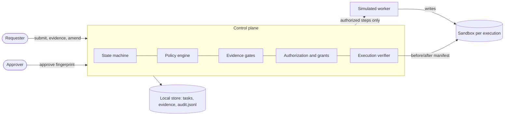
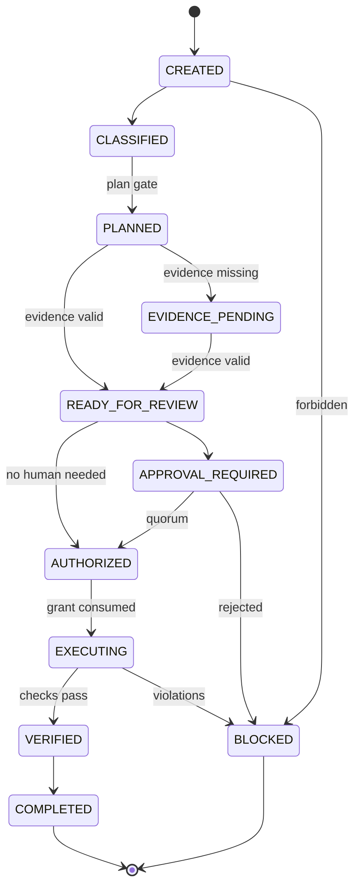
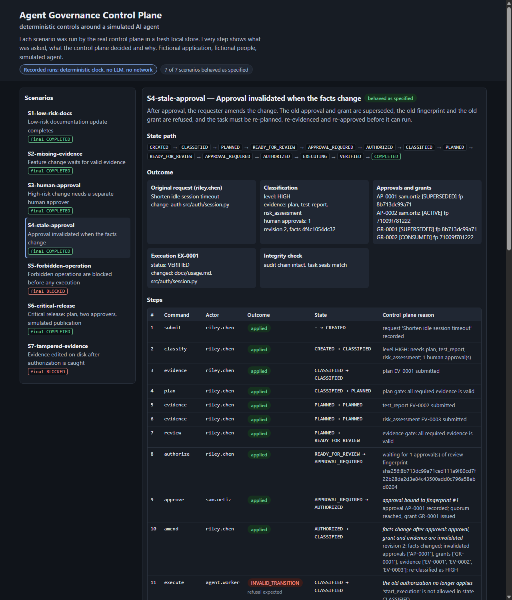

# agent-governance-control-plane

A deterministic control plane that governs the lifecycle of tasks carried out by AI agents: an explicit state
machine, policy-based risk classification, evidence gates, fingerprint-bound human approval, sandboxed execution
and a hash-chained audit log. Python standard library only; runs offline. All projects, people and data are
fictional, and the agent is simulated.

## 1. Project Overview

Ask an agent to change a (fictional) application and this control plane decides, step by step and in code:

- how risky the request is;
- what evidence is needed and whether the evidence is actually valid;
- whether a human must approve, and whether that approval still matches what will run;
- which simulated actions the agent may perform and where;
- whether the result can be accepted.

Seven reproducible scenarios exercise it end to end through a CLI and a static visual demo.

## 2. Problem Statement

Agents are non-deterministic and can be wrong, overconfident or manipulated. Wrapping them safely needs
engineering controls that do not depend on the agent behaving well:

- the risk of a change is computed from facts, not from what the requester claims;
- evidence is checked for content, freshness and integrity, not just presence;
- an approval covers exactly the content that was reviewed and expires when that content changes;
- the agent can only do what was authorized, only once, and only inside a sandbox;
- every decision, including every refusal, leaves an audit trail.

## 3. Key Features

- **Explicit state machine**: 11 states and a transition table; any unlisted move is refused.
- **Deterministic policy engine**: four risk levels (LOW to CRITICAL) from actions, paths and size; a declared
  lower risk is ignored; unknown actions are forbidden. No LLM is involved in any policy decision.
- **Evidence gates**: digest, JSON Schema, task and revision binding, and semantic checks, re-run at every gate.
- **Human-in-the-loop**: approvals quote a review fingerprint; separation of duties; quorum and roles for
  CRITICAL work; amendments invalidate approvals and grants.
- **Execution boundaries**: a simulated worker with a fixed action catalog, writing only in a per-execution
  sandbox; its output is verified, never trusted.
- **Release plans** that reach "generated", "authorized" and "simulated", and never claim a deployment.
- **Audit and concurrency**: hash-chained log, sealed task documents, file lock plus compare-and-swap, one
  execution per grant.

## 4. Architecture



Every command runs the same pipeline: load and integrity-check the task, apply guards, move along a listed
transition, write an audit entry, commit with compare-and-swap. Details:
[docs/architecture.md](docs/architecture.md).

## 5. State Machine



Plus `amend` from CLASSIFIED through AUTHORIZED back to CLASSIFIED, and `block` from any non-terminal state.
Full table, rules and tested invariants: [docs/state-machine.md](docs/state-machine.md).

## 6. Policy & Evidence Gates

| Level | Typical trigger | Evidence | Human approvals |
| --- | --- | --- | --- |
| LOW | documentation, tests | plan | none (policy grant) |
| MEDIUM | source or dependency change | plan, passing test report | none (policy grant) |
| HIGH | `src/auth/**`, migrations, 10+ steps | plus risk assessment | 1, not the requester |
| CRITICAL | publishing a release | plus release plan | 2 distinct, one release manager |

Evidence is never accepted because a file exists: each gate re-checks its digest, schema, binding to the task
and to the current facts, and its meaning (tests passed, plan matches the steps, assessment not below the level).
Classification criteria and the limits of the model: [docs/policy-and-evidence.md](docs/policy-and-evidence.md).

## 7. Human Authorization

An approver runs `agentgov show TASK`, inspects it, then approves the exact review fingerprint it printed. That
fingerprint covers the facts, level, policy, requirements and evidence digests. Change any of them and the
approval no longer applies; amend the facts and every approval and grant is superseded. The requester can never
approve their own task, and agents can never approve anything.

This is a **local demonstration control**: actors come from a JSON file and are not authenticated. See
[docs/human-authorization.md](docs/human-authorization.md).

## 8. Execution Boundaries

The simulated worker knows eight actions, for example writing approved content, a simulated test run or a
simulated publication. It cannot run commands, use the network, read secrets or leave its sandbox, and a test
enforces its imports. After it runs, the control plane checks the steps it reports, every changed file, the exact
content written and the simulated test result. Claims in the agent's report are ignored. A crash, an escape
attempt or an unauthorized file change ends in BLOCKED. See
[docs/execution-and-release.md](docs/execution-and-release.md).

## 9. Demo Walkthrough

```bash
python -m agentgov demo -v            # run the seven scenarios, print every step
```

Open `demo/index.html` (no server needed) to browse the recorded traces: state path, every command with the
control plane's reason, approvals and grants, execution result, and the hash-chained audit trail.

| Scenario | Shows | Final |
| --- | --- | --- |
| S1 low-risk-docs | LOW change, policy grant, sandboxed execution | COMPLETED |
| S2 missing-evidence | Declared LOW ignored; failing tests do not count; waits in EVIDENCE_PENDING | COMPLETED |
| S3 human-approval | Requester, agent and non-approver refused; double approval and second execution refused | COMPLETED |
| S4 stale-approval | Amendment after approval; old fingerprint and old grant refused; re-approval | COMPLETED |
| S5 forbidden-operation | Shell, deployment and a disguised source edit blocked before anything runs | BLOCKED |
| S6 critical-release | Release plan, two approvers incl. release manager, simulated publication | COMPLETED |
| S7 tampered-evidence | Evidence edited on disk after authorization is caught at execution | BLOCKED |



Using the CLI directly (any shell; `--home` defaults to `.agentgov`):

```bash
python -m agentgov init
python -m agentgov explain request.json          # dry-run classification with findings
python -m agentgov submit request.json --actor riley.chen
python -m agentgov show TASK-0001                # state, gates, fingerprints, next events
python -m agentgov audit --task TASK-0001
python -m agentgov verify                        # audit chain + task seals + evidence digests
```

## 10. Testing

91 tests with `unittest`: state-machine invariants, classification, schemas, evidence checks, full lifecycles,
approvals and invalidation, threads and separate OS processes racing to execute, rogue workers, audit tampering
and every scenario, plus a drift check that the committed demo data equals a fresh run.

```bash
python -m unittest discover -s tests -t . -v
python -m agentgov demo --out demo/data.js --check
```

Latest local run (2026-11-23, Windows, Python 3.11): 91 tests run, 90 passed and 1 skipped (the symlink-escape
test, because creating symlinks needs extra privileges on that machine; a skip is not a pass); 7/7 scenarios
behaved as specified. GitHub Actions runs the same on Ubuntu and Windows with Python 3.11 to 3.13; results are in
the repository's Actions tab. Details: [docs/testing.md](docs/testing.md).

## 11. Implementation Status

| Status | Items |
| --- | --- |
| **Implemented** | State machine, policy engine, evidence gates, fingerprints, approvals and grants, amendment invalidation, sandbox and verification, release plans, audit chain and task seals, lock and compare-and-swap, CLI, seven scenarios, static demo, tests, CI workflow |
| **Simulated** | The agent (deterministic worker), the application (synthetic files), test runs and publication (records only), CI evidence (fictional sources), actor identities (local JSON) |
| **Planned** | Signed approvals, an identity provider in front of the CLI, append-only external audit storage, policy-as-data authoring tools, a real agent adapter behind the same worker interface |
| **Not Tested** | macOS; network or shared filesystems for the store; real agents; anything beyond the demo scale |

## 12. Limitations

- Classification reads action names, paths and step counts, not the content of a change.
- No authentication: `--actor` is trusted. Hashes detect naive tampering, not someone who rewrites the whole
  store; they are not signatures.
- One machine, one store directory; a crash during execution leaves EXECUTING for an operator to resolve.
- The worker is a stand-in. Real agents would need the same boundary enforced by an OS-level sandbox, not only
  by path checks.
- The policy is an example for a fictional application, not a recommendation for real systems.

## 13. Roadmap

1. Sign approvals and audit entries with per-actor keys; verify signatures in `agentgov verify`.
2. Put the CLI behind an identity provider and map roles from claims.
3. Ship audit entries to append-only storage outside the control plane's reach.
4. Adapter interface for a real agent running in an OS-level sandbox, verified exactly like the simulated one.
5. Policy linting: unreachable rules, overlapping globs, levels without requirements.

## 14. AI-Assisted Development Disclosure

Built with AI assistance: the code, tests and documentation were drafted with Claude Code (Anthropic) under the
author's direction. The author defined the scope, constraints and acceptance criteria and is responsible for
reviewing and approving every change before publication. Test results, scenario traces and screenshots come from
actual local runs. No language model takes part in any decision the control plane makes.
