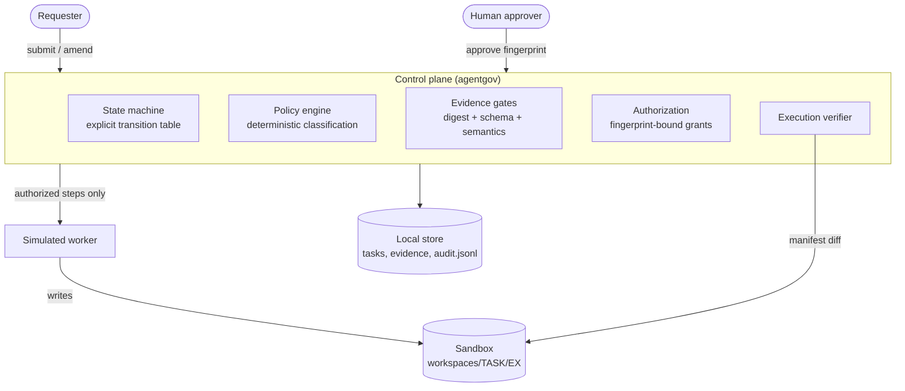

# Architecture

The control plane sits between people who ask for work, an AI agent that does it, and the files it may touch.
It never trusts the agent, the requester's own risk estimate or a file merely because it exists. Everything it
decides is deterministic code over data; no language model is involved.



## Components

| Module | Responsibility |
| --- | --- |
| `states.py` | The 11 states, the `(state, event) -> targets` table, terminal states, `transition()` |
| `policy.py` | Risk classification, path globbing, path safety, per-level requirements |
| `evidence.py` | Facts fingerprint, evidence checks, the evidence gate |
| `engine.py` | `ControlPlane`: every command (guard, transition, audit, compare-and-swap commit), review fingerprint, grants, execution verification |
| `actors.py` | Local actor directory with roles (engineer, approver, release_manager, agent) |
| `sandbox.py`, `worker.py` | Path-contained sandbox and the deterministic simulated agent |
| `release.py` | Release plan content and stages |
| `store.py` | File lock, atomic writes, optimistic versioning, hash-chained audit log with task seals |
| `schema.py`, `schemas/` | JSON Schema documents and a standard-library validator for the subset they use |
| `scenarios.py`, `scenarios/` | Reproducible demo scenarios with expected outcomes per step |
| `cli.py` | `python -m agentgov ...` |

## Command shape

Every mutating command runs the same pipeline:

1. **Load** the task and its seal (the digest recorded by its last applied audit entry) under the store lock.
2. **Integrity**: the document must match its seal, the facts must match their fingerprint, and the stored
   classification must match a fresh classification under the pinned policy.
3. **Guards**: actor role, separation of duties, evidence gates, fingerprints, grant state.
4. **Transition** along a listed edge of the state machine (or refuse with `INVALID_TRANSITION`).
5. **Audit** entry with actor, states, reason, evidence references and the new document digest.
6. **Commit** with compare-and-swap on `version`; a stale writer gets `CONCURRENT_UPDATE`.

A refused command writes only a `rejected` audit entry; the task is unchanged.

## Store layout

```
.agentgov/
  policy.json         pinned into each classification by digest
  actors.json         demo roles (not an identity provider)
  tasks/TASK-0001.json
  evidence/TASK-0001/EV-0001.json
  workspaces/TASK-0001/EX-0001/   sandbox for one execution
  audit.jsonl         hash-chained, append-only by convention
  counters.json, .lock
```

## Design decisions

- **Data-driven rules, code-driven decisions.** The policy file holds actions, path rules and requirements;
  the engine that applies them is small, deterministic and tested exhaustively.
- **Fail closed.** Unknown actions are forbidden, unmatched paths are HIGH, missing evidence routes to
  `EVIDENCE_PENDING`, any integrity mismatch refuses the command.
- **Two fingerprints.** Evidence binds to the facts fingerprint; approvals bind to a review fingerprint that also
  covers the level, policy, requirements and exact evidence digests (see `human-authorization.md`).
- **The agent is outside the trust boundary.** It receives only authorized steps, writes only in a sandbox, and
  its report is verified against the sandbox, never accepted as proof.
- **Standard library only.** No dependencies, offline by construction, identical on Windows and Linux.
