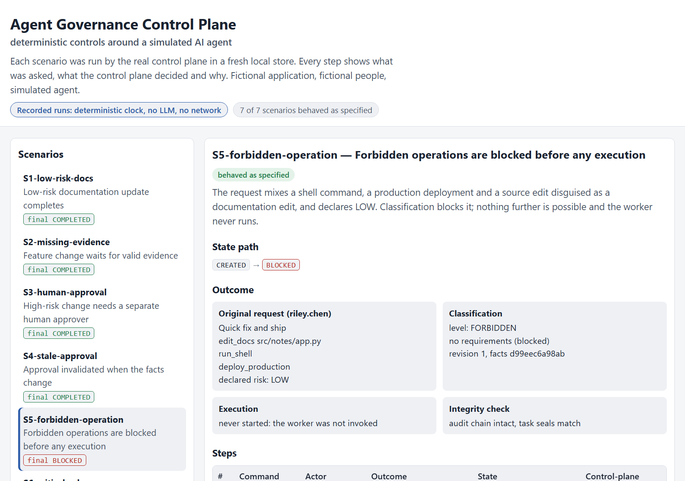

# Policy and evidence gates

## Classification

The level of a task is the **maximum** over every rule it triggers. The demo policy is
`agentgov/data/policy.json`; its digest is pinned into each classification.

| Source | Rule |
| --- | --- |
| Action catalog | `edit_docs`, `add_tests`, `run_tests` LOW; `edit_source`, `update_dependency` MEDIUM; `change_auth`, `prepare_release` HIGH; `publish_release` CRITICAL |
| Path rules | `docs/**`, `*.md`, `tests/**` LOW; `src/**`, `requirements.txt` MEDIUM; `src/auth/**`, `src/migrations/**` HIGH; `secrets/**`, `**/.env*` forbidden |
| Action scope | Each action may only write its own globs (`edit_docs` cannot touch `src/`), so a risky change cannot be disguised as a harmless action |
| Unmatched paths | HIGH (conservative default) |
| Escalation | 10 or more steps: at least HIGH |
| Declared risk | May raise the level; a lower declaration is recorded as ignored |

**Forbidden** (classification moves the task to BLOCKED): any action in the forbidden list (`run_shell`,
`deploy_production`, `read_secrets`, `delete_repository`, `call_external_api`, `disable_tests`), any action not
in the catalog, paths that are absolute, contain `..`, backslashes or drive letters, writes outside an action's
scope, missing or superfluous paths, duplicate steps, release actions without `release.version`.

### Requirements per level

| Level | Evidence | Human approvals |
| --- | --- | --- |
| LOW | plan | none; authorized by policy |
| MEDIUM | plan, test_report | none; authorized by policy |
| HIGH | plan, test_report, risk_assessment | 1 approver who is not the requester |
| CRITICAL | plan, test_report, risk_assessment, release_plan | 2 distinct approvers, at least one release manager |

Any task with a release action also needs a release plan, whatever its level.

### Limits of the model

The classifier sees only what the request declares: action names, paths and step counts. It does not read the
content of a change, so a damaging edit inside a LOW path stays LOW. Path globs are a proxy for blast radius, not
a measurement of it. The rules are illustrative for a fictional application and are not a recommended policy for
real systems. The safeguards against these limits are human review at HIGH and above, execution verification and
the audit trail.

## Evidence

Each record carries an id, type, status (SUBMITTED, SUPERSEDED, STALE), fictional source, submitter, creation
time, revision, content reference and the SHA-256 digest of the stored content.

**Submission is not acceptance.** Every gate re-reads the content and checks, in order:

1. The file exists.
2. Its digest still equals the digest registered at submission (detects edits on disk).
3. It matches the JSON Schema for its type.
4. It is bound to this task and to the current facts fingerprint (detects reuse across tasks or revisions).
5. Consistency checks on what the evidence declares. The evidence is self-declared JSON submitted by a person;
   nothing is executed to produce or confirm it (a test report says tests passed, it does not run them):
   - `plan` covers exactly the requested steps.
   - `test_report` counts add up, at least one test ran, none failed, result PASS.
   - `risk_assessment` does not assess below the computed level.
   - `release_plan` matches the version, the release id, the requested steps and the digests of the current
     evidence.

Agents cannot submit evidence, and release plans can only be generated by the control plane.

### Gates

| Gate | When | Checks |
| --- | --- | --- |
| plan gate | `plan` | plan evidence |
| evidence gate | `review` | all required evidence |
| release-plan gate | `release-plan` | all required evidence except the release plan |
| authorization gate | `authorize` | all required evidence, again |
| approval gate | each `approve` | all required evidence, again |
| execution gate | `execute` | all required evidence, again, plus the grant's fingerprint |

Re-checking at every step is what catches evidence edited after a gate already passed (scenario S7).
