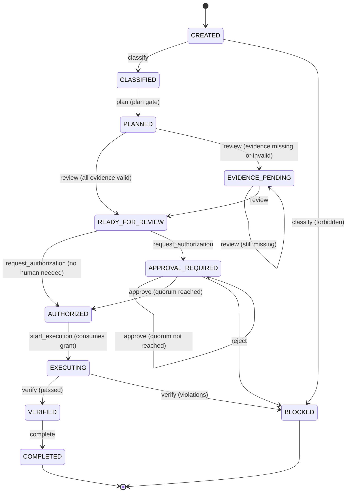

# State machine

Not drawn, to keep the diagram readable: `amend` from CLASSIFIED, PLANNED, EVIDENCE_PENDING, READY_FOR_REVIEW,
APPROVAL_REQUIRED or AUTHORIZED back to CLASSIFIED (or BLOCKED if the new facts are forbidden), and `block` from
every non-terminal state to BLOCKED.

## Rules

- The table in `agentgov/states.py` is the only source of legal moves. Commands call `transition()`, which
  raises `INVALID_TRANSITION` for any `(state, event)` pair or target not listed.
- Guards choose between listed targets (for example READY_FOR_REVIEW or EVIDENCE_PENDING after `review`); they
  can never reach an unlisted state.
- **Terminal states:** COMPLETED and BLOCKED. Nothing leaves them.
- **Fail-safe routing:** missing or invalid evidence moves the task to EVIDENCE_PENDING rather than refusing
  silently, so the reason is recorded in the audit log.
- **Amendment** is possible only before execution starts. It increments the revision, marks evidence STALE,
  supersedes approvals and grants, re-classifies, and returns to CLASSIFIED. A task can never jump back into
  AUTHORIZED: it must be planned, evidenced and authorized again.
- **Execution** is entered only from AUTHORIZED, and COMPLETED only from VERIFIED.

## Two design choices

The state set is the 11 states above. Two choices are worth stating:

- `PLANNED -> READY_FOR_REVIEW` is a direct, listed edge when every required evidence item is already valid, so
  a LOW task does not pass through an empty EVIDENCE_PENDING stop. EVIDENCE_PENDING is entered only when
  something is actually missing.
- There is no CANCELLED state; `block` with a reason covers deliberate stops and keeps the terminal set small.

## Invariants checked by `tests/test_states.py`

Every listed edge is accepted; every unlisted `(state, event, target)` combination (over 1,000) is refused;
terminal states have no exits; every state is reachable from CREATED; every non-terminal state can be blocked;
EXECUTING is entered only from AUTHORIZED; COMPLETED only from VERIFIED; amendment is impossible once execution
has started.
